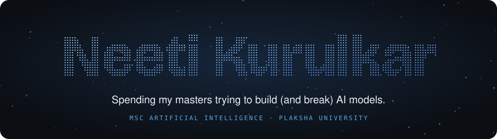

  
  
  

I'm doing an **MSc in Artificial Intelligence at Plaksha University**. Most of my work is about AI systems that hold up outside the demo: agents, retrieval, evaluation, and finding out honestly where a model fails.

- 🎓 **Now:** MSc AI, Plaksha University (2026 – 2027)
- 💼 **Before:** Full Stack Developer Intern at Out of the Blue, Inc. · Software Developer Intern at Plural Technology
- 📚 **B.E. Computer Science**, Savitribai Phule Pune University, CGPA 9.3 / 10

## Featured work

<table>
  <tr>
    <td width="50%" valign="top">
      <h3>🛡️ Injection failures in a bank bot</h3>
      Prompt injection against a tool-using support agent for a fictional Indian bank, across three models and four language variants.
        
      <b>27.6% → 13.6%</b> attack success under the defense · <b>0 of 1,824</b> cross-customer leaks
        
      <a href="https://neeti-kurulkar.github.io/bot-injection-eval/">Dashboard</a> · <a href="https://github.com/neeti-kurulkar/bot-injection-eval">Code</a>
    </td>
    <td width="50%" valign="top">
      <h3>📈 Financial news sentiment reader</h3>
      A fine-tuned DistilBERT that labels a week of real headlines for a ticker, then checks whether any of it is worth anything.
        
      <b>82%</b> fine-tuned accuracy · predicts the stock? <b>no</b>, and it says so
        
      <a href="https://youtu.be/2MEHOc2EDn0">Walkthrough</a> · <a href="https://github.com/neeti-kurulkar/plaksha-python-mini-capstone">Code</a>
    </td>
  </tr>
  <tr>
    <td width="50%" valign="top">
      <h3>🎮 Choose Your Chaos</h3>
      A short, sarcastic, comic-panel choose-your-path game about everyday safety situations for women in India.
        
      <b>4</b> playable scenarios · no backend · full accessibility pass
        
      <a href="https://neeti-kurulkar.github.io/choose-your-chaos/">Play it</a> · <a href="https://github.com/neeti-kurulkar/choose-your-chaos">Code</a>
    </td>
    <td width="50%" valign="top">
      <h3>💬 Text-to-SQL financial analytics</h3>
      Ask financial questions in plain English, answered by a six-agent LangGraph pipeline on a multi-tenant platform.
        
      <b>6</b> agents · RBAC across organisations · ChromaDB few-shot retrieval
        
      <a href="https://finq.web.app/">Open finq</a> · <a href="https://github.com/neeti-kurulkar/be-project-text-to-sql">Code</a>
    </td>
  </tr>
</table>

<b>More projects</b>

 

| Project | What it is |
|---|---|
| [RegTech compliance copilot](https://github.com/neeti-kurulkar/regtech-copilot) | Compliance assistant for Indian non-bank lenders that cites every claim |
| [CodeMorph](https://github.com/adv-11/TheBetterHack-2025) | Four-agent Autogen pipeline for legacy code migration (won The Better Hack) |
| [Disaster Resilience Platform](https://github.com/adv-11/Disaster_Resilience_Platform) | SOS alerts, resource mapping and volunteer coordination with Watsonx.ai |
| [PMAY-G Insights Dashboard](https://github.com/neeti-kurulkar/gramnivesh-avishkar-project) | Rural housing funds from state down to panchayat, queried with generated SQL |
| [Sansthaein Aur Samvidhan](https://www.youtube.com/watch?v=txhCER6uMyA) | The Indian Constitution as interactive 3D gameplay in Unreal Engine |
| [Cold Email Generator](https://github.com/neeti-kurulkar/cold-email-generator) | Personalised internship outreach from job posts and student portfolios |

## Toolbox

  

Also: LangChain · LangGraph · Autogen · ChromaDB · pandas · Pydantic · Databricks · IBM Cloud

## Wins

| | |
|---|---|
| 🥇 **1st** | The Better Hack 2025, city-wide hackathon, Pune |
| 🏅 **Top 10** | IBM SkillsBuild Hackathon 2025, of 70+ entries, state level |
| 🏅 **6th** | Smart India Hackathon 2024, of 500+ entries, EdTech |

There's a ghost on <a href="https://neeti-kurulkar.github.io/">my site</a>. Go say hi 👻

